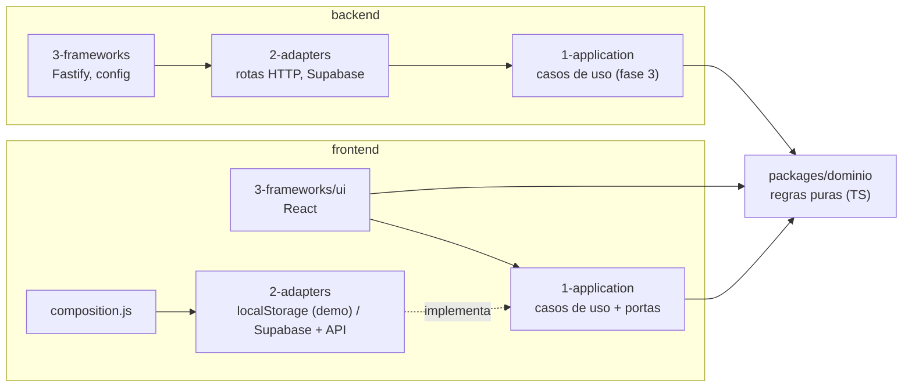

# Arquitetura

O HortiLink é um **monorepo pnpm** em **Clean Architecture** com camadas numeradas, no modelo do artigo [Clean architecture in React app](https://philrich.dev/clean-architecture-react/). As regras de negócio ficam num pacote só, usado pelo front-end (experiência do usuário) e pelo back-end (fonte da verdade).

```
hortilink/
├── packages/dominio/   @hortilink/dominio: regras puras em TypeScript (camada 0)
├── packages/banco/     @hortilink/banco: tabelas do Supabase ↔ estado do domínio (puro, usado por adapters)
├── frontend/           React 19 + Vite: camadas 1 a 3 do app
├── backend/            API Fastify + TypeScript: camadas 1 a 3 do servidor
├── supabase/           (fase 2) migrations SQL com RLS e seed fictício
└── docs/
```

## Visão geral



**Regra da dependência:** os imports só apontam para dentro: `3-frameworks → 2-adapters → 1-application → @hortilink/dominio`. O domínio não importa nada de fora dele.

## Domínio (`packages/dominio/src`)

Um arquivo por agregado, cada um com o seu teste:

| Arquivo | Conteúdo |
|---|---|
| `constantes.ts` | perfis, categorias, unidades, status (oferta, pedido, proposta, estoque), eventos, métodos de pagamento, motivos de perda |
| `tipos.ts` | entidades (`Usuario`, `Produto`, `Oferta`, `Loja`, `Pedido`, `Proposta`, `MovimentoEstoque`, `Despesa`), `Estado` e `Resultado` |
| `formatacao.ts` | `brl`, `num`, `dataCurta`, `dataHora`, `km`, `inicial` |
| `usuarios.ts` · `produtos.ts` · `ofertas.ts` · `lojas.ts` | cadastro, catálogo, ofertas e ponto de coleta |
| `compra.ts` · `pedidos.ts` · `propostas.ts` | validação de compra, pedido direto, pagamento, entrega e propostas |
| `estoque.ts` · `despesas.ts` · `indicadores.ts` | entradas, perdas, alerta de reposição, custos/investimentos e relatórios |
| `exemplo.ts` | dados fictícios (`@hortilink/dominio/exemplo`), usados no modo demonstração, nos testes e no seed do banco |
| `testes.ts` | auxiliares tipados de teste (`sucesso`, `falhaDe`, `porId`) |

**Contrato de toda regra:** `(estado, dados, agora?) → { ok: true, state, ... } | { ok: false, error }`. Nada de `throw` no domínio; a data atual entra como parâmetro para os testes serem determinísticos.

## Front-end (`frontend/src`)

```
1-application/      casos de uso assíncronos (locais e remotos) + portas (JSDoc)
2-adapters/         demo: localStorageRepository + mock/seed.js · conectado: supabaseLeitura, supabaseAutenticacao, apiEscrita
3-frameworks/ui/    React: state/AppProvider, layout/, components/base (genéricos), components/, screens/
composition.js      único lugar que escolhe o modo (variáveis VITE_*)
```

Aliases (em `vite.config.js` e `jsconfig.json`): `@application`, `@adapters`, `@ui`. O domínio é importado pelo nome do pacote: `@hortilink/dominio`.

| Camada | Pode importar | Não pode |
|---|---|---|
| `1-application` | `@hortilink/dominio` | React, adapters |
| `2-adapters` | `@application` (tipos), libs de I/O | telas |
| `3-frameworks/ui` | `@hortilink/dominio`, `useApp()` | `@adapters`, `localStorage` |

## Back-end (`backend/src`)

```
1-application/      (fase 3) casos de uso por agregado + portas (interfaces TS)
2-adapters/http/    rotas Fastify finas (hoje: rotasSaude.ts)
3-frameworks/       config/ambiente.ts (variáveis validadas) e http/servidor.ts (monta o Fastify)
main.ts             lê o ambiente, monta o servidor e abre a porta
```

## Conferir a regra da dependência

```bash
grep -rnE "from \"react|localStorage|fetch\(|fastify" packages/dominio/src       # vazio
grep -rnE "from \"react|localStorage" frontend/src/1-application               # só comentários
grep -rn "@adapters" frontend/src/3-frameworks                                 # vazio
```

## Fluxo de uma ação (ex.: publicar oferta)

1. `OfferForm` chama `addOffer(form)` (de `useApp()`).
2. `AppProvider` chama `casosDeUso.criarOferta(form)`.
3. O caso de uso carrega o estado pelo repositório, aplica `criarOferta` do domínio e, se der certo, salva.
4. Se a regra recusar, o caso de uso lança `Error("mensagem clara")` e a tela mostra em `<ErrorMessage>`.
5. No modo conectado (fase 4), o passo 3 vira uma chamada à API, que roda **a mesma regra** no servidor.

## Como acrescentar

- **Regra nova:** função pura no arquivo do agregado em `packages/dominio/src` + teste no `*.test.ts` dele + export em `index.ts`.
- **Caso de uso no front:** uma linha em `frontend/src/1-application/useCases.js` + ação em `state/AppProvider.jsx`.
- **Tela nova:** arquivo em `screens/<perfil>/`; aba em `layout/navigation.js`; tela em `layout/routes.jsx`.
- **Rota nova na API:** caso de uso em `backend/src/1-application`, rota fina em `2-adapters/http`, registro em `3-frameworks/http/servidor.ts`, teste com `app.inject`.

## Decisões

- **Domínio em TypeScript estrito**, compartilhado; o front continua em JavaScript por enquanto (pode migrar arquivo por arquivo).
- **Sem lib de rotas no front:** navegação por estado (`tab` + `route`). Adotar React Router quando houver URLs compartilháveis.
- **Casos de uso assíncronos** mesmo com storage local, para a API não mudar as telas.
- **Porta "carregar/salvar tudo"** no front só vale para o modo demonstração; com a API, cada caso de uso chama a rota dele (Auditoria MÉDIA-001).
