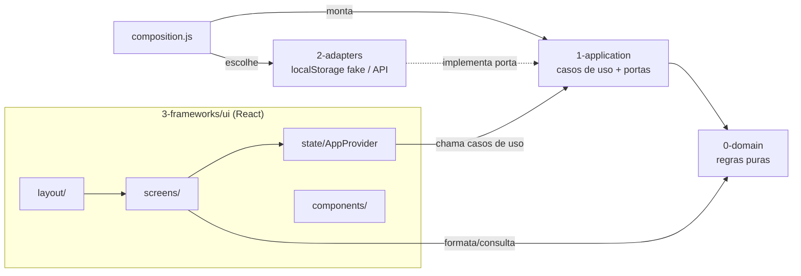

# Arquitetura do front-end

O front-end (`frontend/`) segue **Clean Architecture** com camadas numeradas, no modelo do artigo [Clean architecture in React app](https://philrich.dev/clean-architecture-react/), adaptado para JavaScript.

## Visão geral



**Regra da dependência:** os imports só apontam para dentro: `3-frameworks → 2-adapters → 1-application → 0-domain`. A única peça que conhece todas é a *composition root* (`src/composition.js`).

## Pastas

```
frontend/src/
├── 0-domain/                 Regras de negócio PURAS (sem React, storage ou rede)
│   ├── constants.js          perfis, categorias, unidades, status, eventos do pedido
│   ├── format.js             brl(), num(), dataCurta(), dataHora(), km()
│   ├── regras.js             criarOferta, criarPedidoDireto, pagarPedido, aceitarProposta…
│   ├── regras.test.js
│   └── index.js              API pública da camada
├── 1-application/            Casos de uso e portas
│   ├── ports.js              RepositorioPort (contrato em JSDoc)
│   ├── useCases.js           criarCasosDeUso(repositorio) → { entrar, criarOferta, pagarPedido… }
│   ├── useCases.test.js
│   └── index.js
├── 2-adapters/               Implementações das portas
│   ├── localStorageRepository.js   fake atual (dados no navegador)
│   ├── mock/seed.js          dados fictícios (senha 123456)
│   └── index.js
├── 3-frameworks/ui/          React
│   ├── main.jsx, App.jsx, styles.css
│   ├── state/AppProvider.jsx contexto React: estado para renderizar + ações (useApp)
│   ├── layout/               Shell (menus), navigation.js (abas por perfil), routes.jsx
│   ├── components/base/      componentes genéricos sem regra de negócio (Button, Field, ConfirmModal…)
│   ├── components/           componentes do domínio (StatusBadge, OrderTimeline, pickup/…)
│   ├── screens/              uma tela por arquivo: Auth, produtor/, comprador/, loja/
│   └── App.test.jsx          testes de funcionamento (fluxos completos)
├── composition.js            composition root: escolhe o adapter e monta os casos de uso
└── test/                     setup do Vitest + fixtures (repositório em memória)
```

Aliases (em `vite.config.js` e `jsconfig.json`): `@domain`, `@application`, `@adapters`, `@ui`.

## Responsabilidade de cada camada

| Camada | Pode importar | Não pode | Exemplo |
|---|---|---|---|
| `0-domain` | nada de fora | React, `localStorage`, `fetch` | `criarOferta(estado, dados)` → `{ ok, state }` ou `{ ok: false, error }` |
| `1-application` | `@domain` | React, adapters | `criarOferta: (dados) => executar(regras.criarOferta, dados)` |
| `2-adapters` | `@application` (tipos), libs de I/O | telas | `localStorageRepository.salvar(estado)` |
| `3-frameworks/ui` | `@domain`, `useApp()` | `@adapters`, `localStorage` | `await addOffer(form)` dentro de `try/catch` |

Para conferir a regra no terminal:
```bash
grep -rnE "from \"react|localStorage|fetch\(" frontend/src/0-domain frontend/src/1-application   # só comentários
grep -rn "@adapters" frontend/src/3-frameworks                                                    # vazio
```

## Fluxo de uma ação (ex.: publicar oferta)

1. `OfferForm` chama `addOffer(form)` (de `useApp()`).
2. `AppProvider` chama `casosDeUso.criarOferta(form)`.
3. O caso de uso carrega o estado pelo repositório, aplica `regras.criarOferta` e, se der certo, salva.
4. Se a regra recusar, o caso de uso lança `Error("mensagem clara")` e a tela mostra em `<ErrorMessage>`.
5. Se der certo, o `AppProvider` atualiza o estado do React e a tela re-renderiza.

## Como acrescentar

- **Regra nova:** função pura em `0-domain/regras.js` + teste em `regras.test.js`.
- **Caso de uso:** uma linha em `1-application/useCases.js` + ação em `state/AppProvider.jsx`.
- **Tela nova:** arquivo em `screens/<perfil>/`; aba em `layout/navigation.js`; tela em `layout/routes.jsx`.
- **Back-end:** ver [BACKEND.md](BACKEND.md). Cria-se um adapter novo e troca-se uma linha em `composition.js`.

## Decisões

- **Sem lib de rotas:** navegação por estado (`tab` + `route`) no `Shell`. Adotar React Router quando forem necessárias URLs compartilháveis.
- **Casos de uso assíncronos** mesmo com storage local, para que a API não mude as telas.
- **JavaScript + JSDoc** (sem TypeScript por enquanto, por causa do prazo da Sprint 1).
- **Estado inteiro numa porta (`carregar`/`salvar`)**: simples para o modo demonstração. Com back-end, cada caso de uso passa a chamar a rota correspondente.
